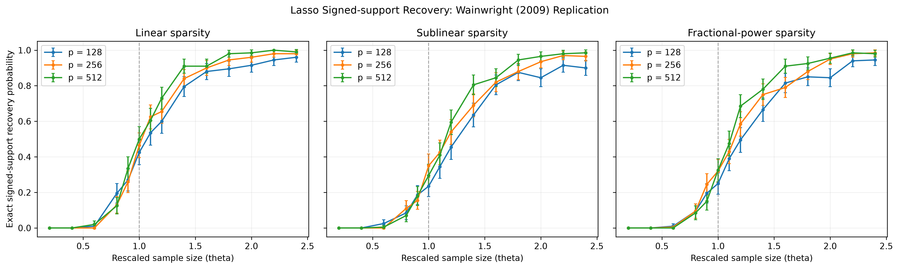
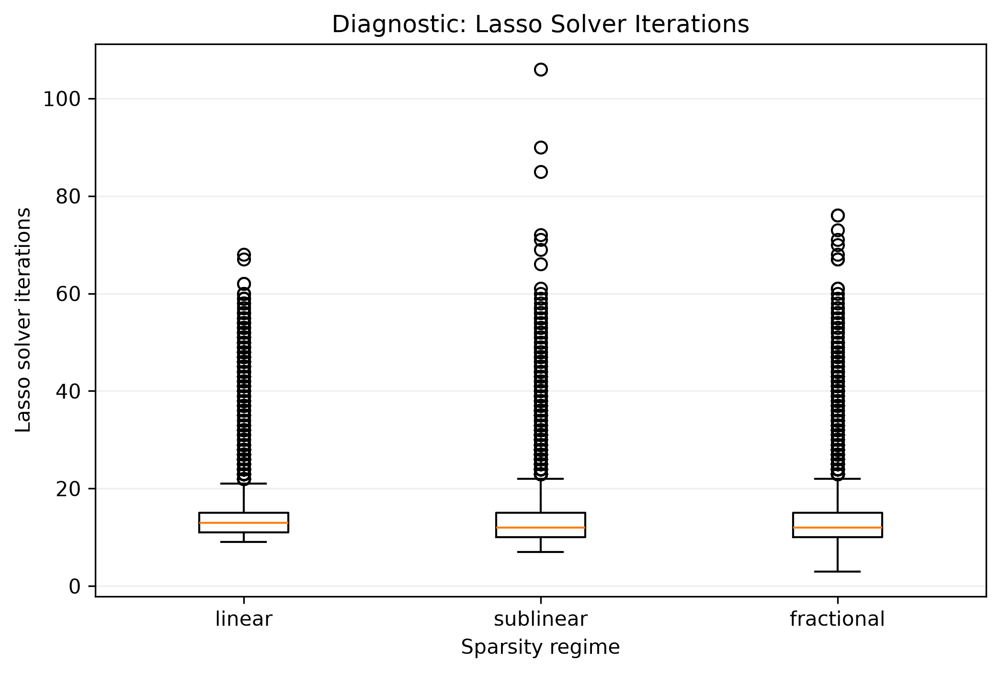

# STATS 607 Unit 2 Project — Simulation Study

## Overview

This project reproduces Figure 2 of Wainwright (2009), which investigates sharp thresholds for exact signed-support recovery using the Lasso in high-dimensional linear regression.

The study examines how recovery probability changes with the rescaled sample size under three sparsity regimes: linear, sublinear, and fractional-power sparsity.

The main goal is to reproduce the qualitative threshold behavior reported in the original paper and evaluate differences between the published and replicated results.

## Simulation Design

The experiment follows the standard Gaussian design described in Section VII of Wainwright (2009).

- **Predictors:** Independent standard Gaussian variables
- **Dimensions:** p = 128, 256, 512
- **Sparsity regimes:** Linear, sublinear, fractional-power
- **Signal strength:** Nonzero coefficients equal to +0.5 or -0.5
- **Noise standard deviation:** 0.5
- **Rescaled sample size:** 14 values of theta from 0.2 to 2.4
- **Monte Carlo replications:** 200 per scenario
- **Total:** 126 scenarios and 25,200 Lasso fits
- **Random seed:** 6072026

The full simulation design, including the sparsity formulas, sample-size scaling, and regularization parameter, is documented in [ADEMP.md](ADEMP.md).

## Requirements

- Python 3.12 or a compatible Python 3 version
- GNU Make or a compatible `make` implementation

The project uses NumPy, pandas, scikit-learn, matplotlib, and pytest.

## Setup

Clone the repository and navigate to the project directory:

```bash
git clone https://github.com/cyongxi/stats607-unit2-project.git
cd stats607-unit2-project
```

Create and activate a virtual environment:

```bash
python3 -m venv .venv
source .venv/bin/activate
```

Install the required packages:

```bash
python -m pip install -r requirements.txt
```

## Running the Simulation

To reproduce the complete simulation study, run:

```bash
make all
```

This command:

1. Generates simulation results for all 126 scenarios.
2. Calculates recovery probabilities and Monte Carlo standard errors.
3. Creates the recovery curves and solver diagnostic plots.

Individual steps can also be executed:

```bash
make simulate
make analyze
make figures
```

Run the automated tests:

```bash
make test
```

Run a small pilot simulation:

```bash
make pilot
```

Remove generated full-simulation results and figures:

```bash
make clean
```


**Estimated runtime:** Approximately 1–2 minutes for the complete simulation pipeline (`make all`) on a MacBook Air with Python 3.12.14. The measured wall-clock runtime was 74.90 seconds for 25,200 Lasso fits, including simulation, analysis, and figure generation. Actual runtime may vary by machine.

## Project Structure

```text
stats607-unit2-project/
├── src/
│   ├── scenarios.py
│   ├── dgps.py
│   ├── methods.py
│   ├── metrics.py
│   ├── simulation.py
│   ├── analyze.py
│   └── figures.py
├── tests/
│   ├── test_dgps.py
│   ├── test_methods.py
│   └── test_metrics.py
├── results/
│   ├── raw/
│   ├── figures/
│   ├── scenario_design.csv
│   └── recovery_summary.csv
├── ADEMP.md
├── ANALYSIS.md
├── Makefile
├── requirements.txt
└── README.md
```

## Outputs

The main generated outputs are:

| File | Description |
|---|---|
| `results/raw/simulation_results.csv` | Replication-level simulation results |
| `results/recovery_summary.csv` | Recovery probabilities and Monte Carlo standard errors |
| `results/figures/recovery_curves.png` | Recovery probability curves across sparsity regimes |
| `results/figures/solver_diagnostics.png` | Lasso solver iteration diagnostics |

### Recovery Probability



### Solver Diagnostics



## Key Findings

The replication reproduces the main qualitative threshold pattern: exact signed-support recovery increases rapidly as the rescaled sample size grows, and the estimated transition midpoint moves toward the theoretical threshold as the problem dimension increases.

However, the reproduced transition locations differ from the published Figure 2, especially in the sublinear and fractional-power sparsity regimes.

For detailed results and critical evaluation, see [ANALYSIS.md](ANALYSIS.md).

## Reference

Wainwright, M. J. (2009). Sharp thresholds for high-dimensional and noisy sparsity recovery using L1-constrained quadratic programming (Lasso). *IEEE Transactions on Information Theory, 55*(5), 2183–2202.
